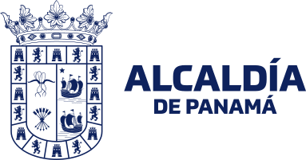
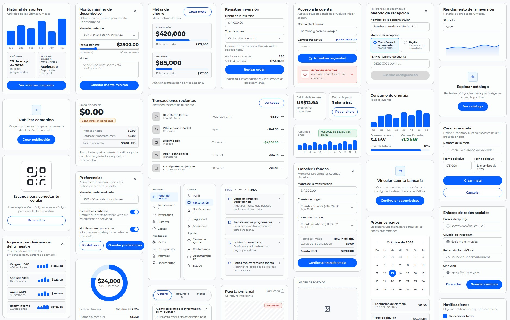

<p align="center">
  
</p>

<h1 align="center">ng-mupa</h1>

<p align="center">
  <strong>Workspace Angular del Lego Design System — Alcaldía de Panamá</strong>
</p>

<p align="center">
  
  
  
  
</p>

<p align="center">
  
</p>

<p align="center">
  <em>Galería de patrones construida con componentes de mupa-ui.</em>
</p>

---

Este workspace contiene la librería **mupa-ui** y el **playground** del
**Lego Design System — Alcaldía de Panamá**.

## Proyectos

| Proyecto                                | Tipo       | Descripción                                         |
| --------------------------------------- | ---------- | --------------------------------------------------- |
| [`mupa-ui`](projects/mupa-ui/README.md) | Librería   | Componentes Angular, tokens, gráficos y branding.   |
| [`playground`](projects/playground)     | Aplicación | Sitio de demostración con ejemplos y documentación. |

## Paquete `mupa-ui`

- Versión **1.0.0**, licencia **Apache 2.0**.
- Más de **50 componentes y directivas**.
- Tokens de diseño, modo oscuro y tipografía Montserrat.
- Gráficos SVG puro: área, barras, líneas, circular, radar, radial y distribución.
- Logos institucionales empaquetados en `assets/branding`.
- Documentación `.md` por componente dentro del paquete.
- [Catálogo completo y guía de uso](projects/mupa-ui/README.md).

### Instalación

```bash
npm install mupa-ui
```

```json
"styles": [
  "node_modules/mupa-ui/tokens.css",
  "node_modules/mupa-ui/forms.css",
  "src/styles.css"
]
```

## Playground

```bash
npm start
```

Disponible en `http://localhost:4200`. Incluye una página por componente, ejemplos
originales y variantes propias.

## Skill para agentes

```text
.opencode/skills/mupa-lego-design-system/SKILL.md
```

La skill enseña a consultar el catálogo y la documentación desde
`node_modules/mupa-ui` y a construir interfaces nuevas con los tokens del
sistema.

## Comandos

| Comando                    | Qué hace                                        |
| -------------------------- | ----------------------------------------------- |
| `npm start`                | Sirve el playground en `http://localhost:4200`. |
| `npm run build`            | Compila la librería en `dist/mupa-ui`.          |
| `npm run build:playground` | Compila el playground.                          |
| `npm test`                 | Ejecuta las pruebas de la librería.             |
| `npm run test:playground`  | Ejecuta las pruebas del playground.             |

## Estructura

```text
projects/
├── mupa-ui/       Librería de componentes, tokens y branding
│   └── src/
│       ├── theme/       tokens.css + fuentes Montserrat
│       └── lib/         componentes, tipos, specs y documentación
└── playground/    Aplicación de demostración
    └── src/app/
        ├── pages/       una página por componente
        └── shared/      tarjetas de demo y visor de documentación
```

## Documentación

- [Catálogo y guía de la librería](projects/mupa-ui/README.md)
- [Convenciones de desarrollo](projects/mupa-ui/AGENTS.md)
- [Tokens de diseño](projects/mupa-ui/src/theme/tokens.md)
- [Skill para agentes](.opencode/skills/mupa-lego-design-system/SKILL.md)

## Licencia

Distribuido bajo **Apache License 2.0**. Consulta [LICENSE](LICENSE) y
[NOTICE](NOTICE).

Copyright 2026 **Flavio Sánchez (Alik)**.

---

<p align="center">
  Hecho para la <strong>Alcaldía de Panamá</strong>.
</p>
