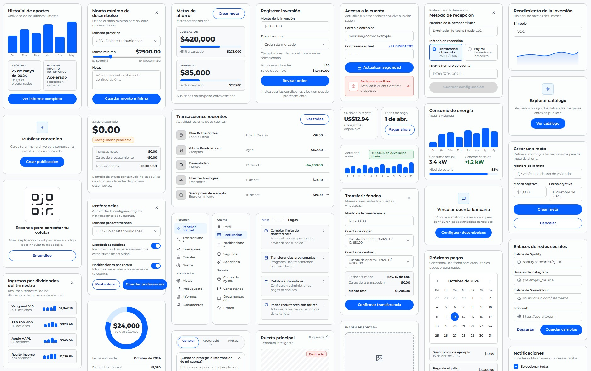

<p align="center">
  
</p>

<h1 align="center">mupa-ui</h1>

<p align="center">
  <strong>Librería Angular del Lego Design System — Alcaldía de Panamá</strong>
</p>

<p align="center">
  
  
  
  
</p>

<p align="center">
  
</p>

<p align="center">
  <em>Galería de patrones construida con componentes de mupa-ui.</em>
</p>

---

**mupa-ui** es la implementación Angular del **Lego Design System — Alcaldía de
Panamá**. Reúne componentes accesibles, tokens de diseño, modo oscuro, gráficos
SVG y recursos de marca para construir interfaces públicas coherentes.

Es un port fiel de la implementación original del sistema y se distribuye bajo
licencia **Apache 2.0**.

## ¿Qué incluye?

| Incluye                | Detalle                                                                                            |
| ---------------------- | -------------------------------------------------------------------------------------------------- |
| **50+ componentes**    | Acciones, formularios, navegación, contenido, mensajes, interacción, gráficos y recursos visuales. |
| **Tokens de diseño**   | Colores institucionales, tipografía, radios, sombras, spacing y z-index.                           |
| **Modo oscuro**        | Tokens semánticos y `data-theme="dark"` en cualquier contenedor.                                   |
| **Accesibilidad**      | HTML semántico, roles, ARIA, teclado, foco visible y contraste AA.                                 |
| **Gráficos**           | Área, barras, líneas, circular, radar, radial y distribución, en SVG puro.                         |
| **Marca**              | `mupa-logo` y assets institucionales empaquetados en `assets/branding`.                            |
| **Documentación**      | Un archivo `.md` por componente dentro del paquete.                                                |
| **Skill para agentes** | `mupa-lego-design-system` para consultar catálogo y tokens.                                        |

## Inicio rápido

```bash
npm install mupa-ui
```

Agrega los estilos globales en `angular.json`:

```json
"styles": [
  "node_modules/mupa-ui/tokens.css",
  "node_modules/mupa-ui/forms.css",
  "src/styles.css"
]
```

Copia los logos institucionales:

```json
{
  "glob": "**/*",
  "input": "node_modules/mupa-ui/assets/branding",
  "output": "assets/branding"
}
```

Usa un componente:

```ts
import { MupaButton, MupaCard } from 'mupa-ui';
```

```html
<mupa-card titulo="Reportes ciudadanos" descripcion="Últimos 30 días">
  <mupa-button iconoInicio="plus">Nuevo reporte</mupa-button>
</mupa-card>
```

> **En el workspace:** usa `projects/mupa-ui/src/theme/tokens.css` mientras
> desarrollas la librería localmente.

## Catálogo de componentes

La documentación de cada componente vive en el paquete como
`lib/<componente>/<componente>.md`. Los enlaces de esta tabla abren la versión
del repositorio.

<details>
<summary><strong>Fundamentos</strong> · 1 componente</summary>

| Componente | Selector    | Documentación                                                                                |
| ---------- | ----------- | -------------------------------------------------------------------------------------------- |
| Icono      | `mupa-icon` | [icon.md](https://github.com/0-ALIK/ng-mupa/blob/main/projects/mupa-ui/src/lib/icon/icon.md) |

</details>

<details>
<summary><strong>Acciones</strong> · 4 componentes</summary>

| Componente      | Selector             | Documentación                                                                                                           |
| --------------- | -------------------- | ----------------------------------------------------------------------------------------------------------------------- |
| Botón           | `mupa-button`        | [button.md](https://github.com/0-ALIK/ng-mupa/blob/main/projects/mupa-ui/src/lib/button/button.md)                      |
| Toggle button   | `mupa-toggle-button` | [toggle-button.md](https://github.com/0-ALIK/ng-mupa/blob/main/projects/mupa-ui/src/lib/toggle-button/toggle-button.md) |
| Chip / etiqueta | `mupa-pill`          | [pill.md](https://github.com/0-ALIK/ng-mupa/blob/main/projects/mupa-ui/src/lib/pill/pill.md)                            |
| Voice pill      | `mupa-voice-pill`    | [voice-pill.md](https://github.com/0-ALIK/ng-mupa/blob/main/projects/mupa-ui/src/lib/voice-pill/voice-pill.md)          |

</details>

<details>
<summary><strong>Formularios</strong> · 8 componentes</summary>

| Componente         | Selector           | Documentación                                                                                                     |
| ------------------ | ------------------ | ----------------------------------------------------------------------------------------------------------------- |
| Casilla            | `mupa-checkbox`    | [checkbox.md](https://github.com/0-ALIK/ng-mupa/blob/main/projects/mupa-ui/src/lib/checkbox/checkbox.md)          |
| Directiva de campo | `mupaInput`        | [input.md](https://github.com/0-ALIK/ng-mupa/blob/main/projects/mupa-ui/src/lib/input/input.md)                   |
| Selector           | `mupa-select`      | [select.md](https://github.com/0-ALIK/ng-mupa/blob/main/projects/mupa-ui/src/lib/select/select.md)                |
| Selector de fecha  | `mupa-date-picker` | [date-picker.md](https://github.com/0-ALIK/ng-mupa/blob/main/projects/mupa-ui/src/lib/date-picker/date-picker.md) |
| Radio              | `mupa-radio`       | [radio.md](https://github.com/0-ALIK/ng-mupa/blob/main/projects/mupa-ui/src/lib/radio/radio.md)                   |
| Switch             | `mupa-switch`      | [switch.md](https://github.com/0-ALIK/ng-mupa/blob/main/projects/mupa-ui/src/lib/switch/switch.md)                |
| Range              | `mupa-range`       | [range.md](https://github.com/0-ALIK/ng-mupa/blob/main/projects/mupa-ui/src/lib/range/range.md)                   |
| Carga de archivos  | `mupa-file-upload` | [file-upload.md](https://github.com/0-ALIK/ng-mupa/blob/main/projects/mupa-ui/src/lib/file-upload/file-upload.md) |

</details>

<details>
<summary><strong>Avatares</strong> · 2 componentes</summary>

| Componente        | Selector            | Documentación                                                                                                        |
| ----------------- | ------------------- | -------------------------------------------------------------------------------------------------------------------- |
| Avatar            | `mupa-avatar`       | [avatar.md](https://github.com/0-ALIK/ng-mupa/blob/main/projects/mupa-ui/src/lib/avatar/avatar.md)                   |
| Grupo de avatares | `mupa-avatar-group` | [avatar-group.md](https://github.com/0-ALIK/ng-mupa/blob/main/projects/mupa-ui/src/lib/avatar-group/avatar-group.md) |

</details>

<details>
<summary><strong>Navegación</strong> · 6 componentes</summary>

| Componente          | Selector           | Documentación                                                                                                     |
| ------------------- | ------------------ | ----------------------------------------------------------------------------------------------------------------- |
| Navegación lateral  | `mupa-sidebar`     | [sidebar.md](https://github.com/0-ALIK/ng-mupa/blob/main/projects/mupa-ui/src/lib/sidebar/sidebar.md)             |
| Ruta de navegación  | `mupa-breadcrumb`  | [breadcrumb.md](https://github.com/0-ALIK/ng-mupa/blob/main/projects/mupa-ui/src/lib/breadcrumb/breadcrumb.md)    |
| Menú de landing     | `mupa-landing-nav` | [landing-nav.md](https://github.com/0-ALIK/ng-mupa/blob/main/projects/mupa-ui/src/lib/landing-nav/landing-nav.md) |
| Espécimen de enlace | `mupa-nav-link`    | [nav-link.md](https://github.com/0-ALIK/ng-mupa/blob/main/projects/mupa-ui/src/lib/nav-link/nav-link.md)          |
| Paginación          | `mupa-pagination`  | [pagination.md](https://github.com/0-ALIK/ng-mupa/blob/main/projects/mupa-ui/src/lib/pagination/pagination.md)    |
| Menú                | `mupa-menu`        | [menu.md](https://github.com/0-ALIK/ng-mupa/blob/main/projects/mupa-ui/src/lib/menu/menu.md)                      |

</details>

<details>
<summary><strong>Contenido</strong> · 5 componentes y directivas</summary>

| Componente         | Selector                                                                  | Documentación                                                                                                     |
| ------------------ | ------------------------------------------------------------------------- | ----------------------------------------------------------------------------------------------------------------- |
| Tarjeta            | `mupa-card`                                                               | [card.md](https://github.com/0-ALIK/ng-mupa/blob/main/projects/mupa-ui/src/lib/card/card.md)                      |
| Ranuras de tarjeta | `mupaCardMedia` · `mupaCardHeader` · `mupaCardFooter` · `mupaCardActions` | [card.md](https://github.com/0-ALIK/ng-mupa/blob/main/projects/mupa-ui/src/lib/card/card.md)                      |
| Cabecera de página | `mupa-page-header`                                                        | [page-header.md](https://github.com/0-ALIK/ng-mupa/blob/main/projects/mupa-ui/src/lib/page-header/page-header.md) |
| Tabla de datos     | `mupa-data-table`                                                         | [data-table.md](https://github.com/0-ALIK/ng-mupa/blob/main/projects/mupa-ui/src/lib/data-table/data-table.md)    |
| Plantilla de tabla | `mupaTemplate`                                                            | [data-table.md](https://github.com/0-ALIK/ng-mupa/blob/main/projects/mupa-ui/src/lib/data-table/data-table.md)    |

</details>

<details>
<summary><strong>Mensajes y estados</strong> · 10 componentes</summary>

| Componente             | Selector                  | Documentación                                                                                                              |
| ---------------------- | ------------------------- | -------------------------------------------------------------------------------------------------------------------------- |
| Aviso informativo      | `mupa-banner`             | [banner.md](https://github.com/0-ALIK/ng-mupa/blob/main/projects/mupa-ui/src/lib/banner/banner.md)                         |
| Lattice loader         | `mupa-lattice-loader`     | [lattice-loader.md](https://github.com/0-ALIK/ng-mupa/blob/main/projects/mupa-ui/src/lib/lattice-loader/lattice-loader.md) |
| Burbuja                | `mupa-bubble`             | [bubble.md](https://github.com/0-ALIK/ng-mupa/blob/main/projects/mupa-ui/src/lib/bubble/bubble.md)                         |
| Contenido de burbuja   | `mupa-bubble-content`     | [bubble.md](https://github.com/0-ALIK/ng-mupa/blob/main/projects/mupa-ui/src/lib/bubble/bubble.md)                         |
| Sugerencias            | `mupa-bubble-suggestions` | [bubble.md](https://github.com/0-ALIK/ng-mupa/blob/main/projects/mupa-ui/src/lib/bubble/bubble.md)                         |
| Tarjeta de burbuja     | `mupa-bubble-card`        | [bubble.md](https://github.com/0-ALIK/ng-mupa/blob/main/projects/mupa-ui/src/lib/bubble/bubble.md)                         |
| Grupo de burbujas      | `mupa-bubble-group`       | [bubble.md](https://github.com/0-ALIK/ng-mupa/blob/main/projects/mupa-ui/src/lib/bubble/bubble.md)                         |
| Reacciones de burbuja  | `mupa-bubble-reactions`   | [bubble.md](https://github.com/0-ALIK/ng-mupa/blob/main/projects/mupa-ui/src/lib/bubble/bubble.md)                         |
| Notificación           | `mupa-toast`              | [toast.md](https://github.com/0-ALIK/ng-mupa/blob/main/projects/mupa-ui/src/lib/toast/toast.md)                            |
| Pila de notificaciones | `mupa-toaster`            | [toaster.md](https://github.com/0-ALIK/ng-mupa/blob/main/projects/mupa-ui/src/lib/toast/toaster.md)                        |

</details>

<details>
<summary><strong>Interacción</strong> · 4 componentes</summary>

| Componente | Selector         | Documentación                                                                                               |
| ---------- | ---------------- | ----------------------------------------------------------------------------------------------------------- |
| Tabs       | `mupa-tabs`      | [tabs.md](https://github.com/0-ALIK/ng-mupa/blob/main/projects/mupa-ui/src/lib/tabs/tabs.md)                |
| Segmented  | `mupa-segmented` | [segmented.md](https://github.com/0-ALIK/ng-mupa/blob/main/projects/mupa-ui/src/lib/segmented/segmented.md) |
| Acordeón   | `mupa-accordion` | [accordion.md](https://github.com/0-ALIK/ng-mupa/blob/main/projects/mupa-ui/src/lib/accordion/accordion.md) |
| Progreso   | `mupa-progress`  | [progress.md](https://github.com/0-ALIK/ng-mupa/blob/main/projects/mupa-ui/src/lib/progress/progress.md)    |

</details>

<details>
<summary><strong>Gráficos</strong> · 9 componentes</summary>

| Componente            | Selector                | Documentación                                                                                                                    |
| --------------------- | ----------------------- | -------------------------------------------------------------------------------------------------------------------------------- |
| Gráfico de área       | `mupa-area-chart`       | [area-chart.md](https://github.com/0-ALIK/ng-mupa/blob/main/projects/mupa-ui/src/lib/area-chart/area-chart.md)                   |
| Gráfico de barras     | `mupa-bar-chart`        | [bar-chart.md](https://github.com/0-ALIK/ng-mupa/blob/main/projects/mupa-ui/src/lib/bar-chart/bar-chart.md)                      |
| Bar list              | `mupa-bar-list`         | [bar-list.md](https://github.com/0-ALIK/ng-mupa/blob/main/projects/mupa-ui/src/lib/bar-list/bar-list.md)                         |
| Gráfico de líneas     | `mupa-line-chart`       | [line-chart.md](https://github.com/0-ALIK/ng-mupa/blob/main/projects/mupa-ui/src/lib/line-chart/line-chart.md)                   |
| Líneas con etiquetas  | `mupa-line-chart-label` | [line-chart-label.md](https://github.com/0-ALIK/ng-mupa/blob/main/projects/mupa-ui/src/lib/line-chart/line-chart-label.md)       |
| Gráfico circular      | `mupa-pie-chart`        | [pie-chart.md](https://github.com/0-ALIK/ng-mupa/blob/main/projects/mupa-ui/src/lib/pie-chart/pie-chart.md)                      |
| Gráfico de radar      | `mupa-radar-chart`      | [radar-chart.md](https://github.com/0-ALIK/ng-mupa/blob/main/projects/mupa-ui/src/lib/radar-chart/radar-chart.md)                |
| Gráfico radial        | `mupa-radial-chart`     | [radial-chart.md](https://github.com/0-ALIK/ng-mupa/blob/main/projects/mupa-ui/src/lib/radial-chart/radial-chart.md)             |
| Barra de distribución | `mupa-distribution-bar` | [distribution-bar.md](https://github.com/0-ALIK/ng-mupa/blob/main/projects/mupa-ui/src/lib/distribution-bar/distribution-bar.md) |

</details>

<details>
<summary><strong>Marca</strong> · 1 componente</summary>

| Componente         | Selector    | Documentación                                                                                |
| ------------------ | ----------- | -------------------------------------------------------------------------------------------- |
| Logo institucional | `mupa-logo` | [logo.md](https://github.com/0-ALIK/ng-mupa/blob/main/projects/mupa-ui/src/lib/logo/logo.md) |

</details>

<details>
<summary><strong>Recursos visuales</strong> · 6 componentes</summary>

| Componente        | Selector                 | Documentación                                                                                                                       |
| ----------------- | ------------------------ | ----------------------------------------------------------------------------------------------------------------------------------- |
| Confetti          | `mupa-confetti`          | [confetti.md](https://github.com/0-ALIK/ng-mupa/blob/main/projects/mupa-ui/src/lib/confetti/confetti.md)                            |
| Botón de confeti  | `mupa-boton-confeti`     | [confetti.md](https://github.com/0-ALIK/ng-mupa/blob/main/projects/mupa-ui/src/lib/confetti/confetti.md)                            |
| Marquee           | `mupa-marquee`           | [marquee.md](https://github.com/0-ALIK/ng-mupa/blob/main/projects/mupa-ui/src/lib/marquee/marquee.md)                               |
| Testimonio        | `mupa-testimonio`        | [marquee.md](https://github.com/0-ALIK/ng-mupa/blob/main/projects/mupa-ui/src/lib/marquee/marquee.md)                               |
| Contador numérico | `mupa-contador-numerico` | [contador-numerico.md](https://github.com/0-ALIK/ng-mupa/blob/main/projects/mupa-ui/src/lib/contador-numerico/contador-numerico.md) |
| Logo loop         | `mupa-logo-loop`         | [logo-loop.md](https://github.com/0-ALIK/ng-mupa/blob/main/projects/mupa-ui/src/lib/logo-loop/logo-loop.md)                         |

</details>

## Temas y tokens

El sistema usa tokens CSS. No escribas colores, tipografías, radios ni sombras
literales: usa las variables de `tokens.css`.

### Modo oscuro

```html
<html data-theme="dark">
  <!-- o en un contenedor concreto -->
  <div data-theme="dark">...</div>
</html>
```

### Tokens principales

| Token                 | Valor                                                                        |
| --------------------- | ---------------------------------------------------------------------------- |
| `--color-primary-500` |  `#0660FF` |
| `--color-primary-900` |  `#0E225D` |
| `--color-neutral-900` |  `#21252B` |
| `--color-success-700` |  `#176B3D` |
| `--color-warning-500` |  `#F59E0B` |
| `--color-error-700`   |  `#B71C1C` |

La documentación completa de fundamentos está en
[tokens.md](https://github.com/0-ALIK/ng-mupa/blob/main/projects/mupa-ui/src/theme/tokens.md).

## Marca y logos

```html
<mupa-logo variante="horizontal" tema="color" tamano="md" />
```

Variantes: `horizontal`, `vertical`, `escudo`, `isotipo`.
Temas: `color`, `blanco`.
Tamaños: `sm`, `md`, `lg`.

Los archivos se publican en `node_modules/mupa-ui/assets/branding`. Para
servirlos, copia esa carpeta en los assets de la aplicación:

```json
{
  "glob": "**/*",
  "input": "node_modules/mupa-ui/assets/branding",
  "output": "assets/branding"
}
```

Más detalles en [logo.md](https://github.com/0-ALIK/ng-mupa/blob/main/projects/mupa-ui/src/lib/logo/logo.md).

## Skill para agentes

El repositorio incluye la skill:

```
.opencode/skills/mupa-lego-design-system/SKILL.md
```

Enseña a consultar el catálogo y la documentación desde `node_modules/mupa-ui`
y a construir interfaces nuevas con los tokens cuando algo no exista en el
catálogo.

## Desarrollo

| Comando                    | Qué hace                                        |
| -------------------------- | ----------------------------------------------- |
| `npm start`                | Sirve el playground en `http://localhost:4200`. |
| `npm run build`            | Compila la librería en `dist/mupa-ui`.          |
| `npm run build:playground` | Compila el playground.                          |
| `npm test`                 | Ejecuta las pruebas de la librería.             |

Convenciones del proyecto:
[AGENTS.md](https://github.com/0-ALIK/ng-mupa/blob/main/projects/mupa-ui/AGENTS.md).

## Compatibilidad

- Angular **22**.
- Componentes **standalone** y estado con **signals**.
- **Sin dependencias de UI externas**: gráficos en SVG puro.
- Licencia **Apache 2.0**.

## Licencia

Distribuido bajo **Apache License 2.0**. Consulta
[LICENSE](https://github.com/0-ALIK/ng-mupa/blob/main/LICENSE) y
[NOTICE](https://github.com/0-ALIK/ng-mupa/blob/main/NOTICE).

Copyright 2026 **Flavio Sánchez (Alik)**.

---

<p align="center">
  Hecho para la <strong>Alcaldía de Panamá</strong>.
</p>
